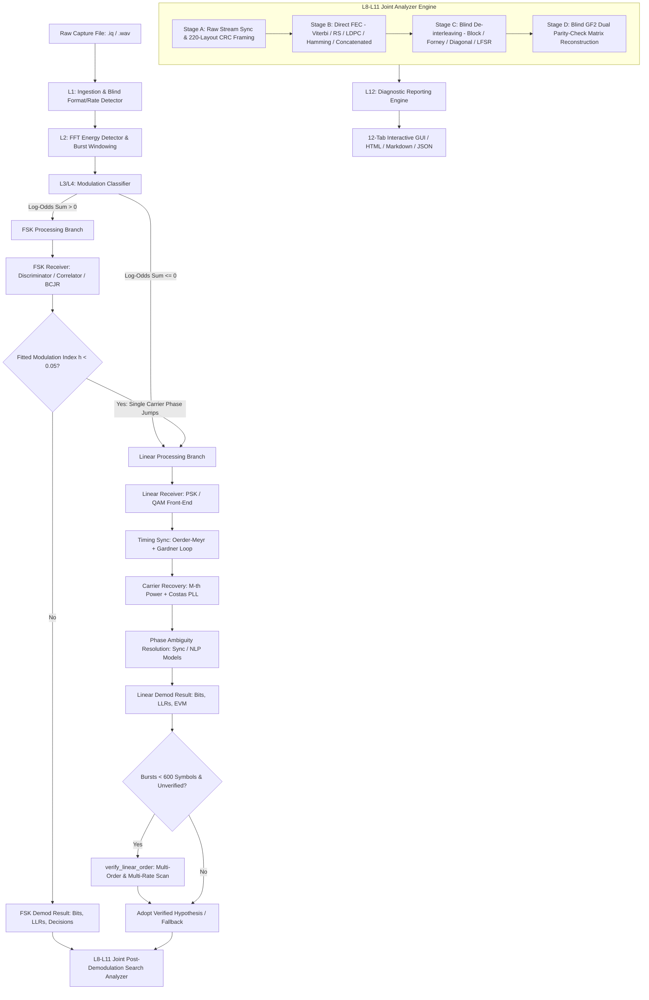

# SIH 26147: Automated Signal Analysis System for `.IQ` and `.wav` Files

[](https://www.python.org/downloads/)
[](https://riverbankcomputing.com/software/pyqt/)
[](https://scipy.org/)
[-red.svg)](https://ntro.gov.in/)
[]()

> **Problem Statement ID:** 26147  
> **Title:** Automated model for analysis of `.IQ` and `.wav` files with signal parameter extraction  
> **Organisation:** National Technical Research Organisation (NTRO) — Theme: Space Technology  

---

## Table of Contents

1. [Executive Overview](#1-executive-overview)
2. [Key Capabilities & Innovations](#2-key-capabilities--innovations)
3. [End-to-End System Architecture](#3-end-to-end-system-architecture)
4. [Layer-by-Layer Technical Specification & Mathematical Foundations](#4-layer-by-layer-technical-specification--mathematical-foundations)
   - [Layer 1: Multi-Format Signal Ingestion & Conditioning](#layer-1-multi-format-signal-ingestion--conditioning)
   - [Layer 2: Energy Detection & Burst Boundary Segmentation](#layer-2-energy-detection--burst-boundary-segmentation)
   - [Layer 3 & 4: Autonomous Modulation Classification](#layer-3--4-autonomous-modulation-classification)
   - [Layer 5 & 6: Digital Demodulation & Synchronization Engines](#layer-5--6-digital-demodulation--synchronization-engines)
   - [Layer 7: Unframed Payload Recovery & Statistical NLP Models](#layer-7-unframed-payload-recovery--statistical-nlp-models)
   - [Layer 8: Bitstream Forensics & Correlation Metrics](#layer-8-bitstream-forensics--correlation-metrics)
   - [Layer 9: Blind De-Interleaving & Matrix Reconstruction](#layer-9-blind-de-interleaving--matrix-reconstruction)
   - [Layer 10: Forward Error Correction (FEC) Forensics & Decoding](#layer-10-forward-error-correction-fec-forensics--decoding)
   - [Layer 11: Protocol Layout Discovery & CRC Parsing](#layer-11-protocol-layout-discovery--crc-parsing)
   - [Layer 12: Parameter Provenance & Automated Report Generation](#layer-12-parameter-provenance--automated-report-generation)
5. [Interactive Graphical User Interface (The 12 Tabs)](#5-interactive-graphical-user-interface-the-12-tabs)
6. [Installation & Operational Workflow](#6-installation--operational-workflow)
7. [Command-Line Tools & Headless Execution](#7-command-line-tools--headless-execution)
8. [Empirical Validation & Benchmark Results](#8-empirical-validation--benchmark-results)
9. [Repository Layout](#9-repository-layout)
10. [Known Operational Boundaries & Constraints](#10-known-operational-boundaries--constraints)
11. [References & Citations](#11-references--citations)

---

## 1. Executive Overview

This repository hosts a production-grade, autonomous software suite for blind and semi-blind digital signal analysis, parameter extraction, demodulation, channel de-interleaving, forward error correction (FEC) decoding, and protocol framing recovery from raw radio frequency (RF) `.iq` and audio/passband `.wav` captures.

Designed to address mission-critical requirements in space communications, electronic intelligence (ELINT), and signal surveillance, the platform executes a 12-stage hierarchical analysis pipeline that extracts deep physical, statistical, modulation, coding, and cryptographic parameters without requiring prior knowledge of the transmitted signal.

```
+---------------------------------------------------------------------------------------------------+
|                                      SIH-26147 PIPELINE CORE                                      |
+---------------------------------------------------------------------------------------------------+
|  [L1 Ingestion]  -->  [L2 Energy/Burst]  -->  [L3/L4 Modulation Classifier]                      |
|         |                                              |                                          |
|         v                                              v                                          |
|  [L5/L6 Sync & Demodulation]  <------------------------+  (FSK / PSK / QAM Receivers)             |
|         |                                                                                         |
|         +--> [L7 Unframed Statistical NLP Engine]  (General / English Bigram / Numeric Models)   |
|         |                                                                                         |
|         v                                                                                         |
|  [L8-L11 Joint Post-Demodulation Search Analyzer]                                                 |
|         +--> [L8 Bitstream Forensics & Sync Search] (Chiani LRT / GLRT)                           |
|         +--> [L9 Blind De-Interleaving] (GF(2) Rank Deficiency / KS Test)                         |
|         +--> [L10 FEC Identification & Decoding] (Viterbi / RS / LDPC / Hamming / Concatenated)    |
|         +--> [L11 Frame & CRC Dissection] (220-Layout Hypothesis Generator)                       |
|         |                                                                                         |
|         v                                                                                         |
|  [L12 Multi-Format Reporting & GUI Visualization] (HTML, Markdown, JSON + 12 PyQt6 Tabs)           |
+---------------------------------------------------------------------------------------------------+
```

---

## 2. Key Capabilities & Innovations

* **Universal Format Ingestion:** Seamless parsing of `CU8`, `CS8`, `CS16`, `CF32`, and `CF64` data layouts (interleaved I/Q, planar, big/little endian) with automatic byte-distribution blind format inference and analytical Hilbert passband-to-baseband conversion for `.wav` files.
* **Autonomous Modulation Classification:** Multi-feature log-odds decision tree and Maximum Likelihood / ALRT classifier discriminating between **FSK** (2FSK, 4FSK, 8FSK, CPFSK, MSK, GFSK, GMSK, Discontinuous FSK) and **Linear** modulations (**BPSK, QPSK/4QAM, 8PSK, 16PSK, 16QAM, 64QAM, 256QAM**).
* **Decode-Validated Order & Rate Verification:** Closed-loop hypothesis scanner resolving ambiguous constellation orders and symbol rates on short, dense bursts.
* **Carrier & Timing Synchronization:**
  * Fractional symbol timing recovery via **Oerder-Meyr** cyclostationary line estimation and **Gardner Timing Error Detector** (TED) with cubic Lagrange interpolation.
  * Carrier frequency & phase recovery using **Viterbi & Viterbi $M$-th power feedforward estimators**, **2nd-order Costas/Decision-Directed PLLs**, and **Sync-Aided Least-Squares refitting**.
* **High-Order CPM Demodulation:** Multi-algorithm FSK receiver combining Quadrature Discriminator, Non-Coherent Correlator Banks, and **Coherent Max-Log BCJR** trellis decoding over continuous-phase states.
* **Blind Post-Demodulation Engine (L8–L11):**
  * Soft/Hard **Chiani–Martini LRT/GLRT** sync-word search with binomial false-alarm bounds.
  * **GF(2) Matrix Rank Deficiency** spectrum and Kolmogorov–Smirnov tests for blind interleaver period extraction.
  * Soft-decision **Viterbi**, **Reed–Solomon** over $GF(2^8)$, **LDPC Normalized Min-Sum**, **Hamming**, and **Iterative Concatenated (RS + Conv)** decoding.
  * Blind parity-check matrix identification via **GF(2) Dual Null-Space information-set reduction**.
  * 220-hypothesis automated protocol framing and CRC table solver.
* **Unframed Statistical NLP Payload Decoders:** Trigram/Bigram English PMI and Numeric probability models resolving phase ambiguities and byte alignments on raw uncoded text streams.
* **Parameter Provenance & Transparency:** Every estimated physical variable is recorded as a structured `Parameter` object with provenance state (`KNOWN`, `ESTIMATED`, `ASSUMED`, `UNKNOWN`), confidence score $\in [0, 1]$, methodology tag, and supporting mathematical evidence items.

---

## 3. End-to-End System Architecture

The following diagram illustrates the complete execution pipeline running inside `gui.workers.unified_worker.UnifiedPipelineWorker`:



---

## 4. Layer-by-Layer Technical Specification & Mathematical Foundations

### Layer 1: Multi-Format Signal Ingestion & Conditioning

#### 1.1 Data Normalization & Formats
Raw samples are read as interleaved in-phase ($I$) and quadrature ($Q$) components:
$$s[n] = I[n] + j \cdot Q[n]$$

Sample format mappings to normalized floating-point range $[-1.0, +1.0)$:
* **CU8 (Unsigned 8-bit):**
  $$v_{\text{float}} = \frac{v_{\text{raw}} - 127.5}{128.0}$$
* **CS8 (Signed 8-bit):**
  $$v_{\text{float}} = \frac{v_{\text{raw}}}{128.0}$$
* **CS16 (Signed 16-bit):**
  $$v_{\text{float}} = \frac{v_{\text{raw}}}{32768.0}$$
* **CF32 / CF64:** Native floating-point IEEE-754 scaling.

#### 1.2 Blind Format & Endianness Detection
When format is unknown, byte entropy and statistical variance are evaluated across three 256 KB chunks:
1. **Float Plausibility:** Re-interpreting bytes as `CF32`/`CF64`. Scored using finite checks, denormal percentage $< 0.1\%$, and median-to-99.9th-percentile ratio:
   $$\text{Score}_{\text{float}} = \text{clip}\left(\frac{6 - \log_{10}(P_{99.9} / \text{median})}{2}, 0, 1\right)$$
2. **8-bit vs 16-bit Roughness:** Evaluates sign-extension match and differential step smoothness:
   $$\mathcal{R} = \frac{\mathbb{E}[|\Delta x|]}{\sigma_x}$$
   If $\mathcal{R}_{\text{int16}} < 0.8 \cdot \mathcal{R}_{\text{int8}}$, or low-byte total variation distance from uniform distribution is $< 1.5 \cdot \text{noise}_{\text{sampling}} + 0.02$, `CS16` is confirmed.
3. **CU8 vs CS8 Offset:** Selects offset minimizing mean absolute step $|\Delta v|$ to prevent zero-crossing jumps ($\approx 255$).

#### 1.3 Analytic Baseband Downconversion for Real Passband WAVs
For mono or identical stereo `.wav` files, the real passband signal $x_{\text{real}}[n]$ is converted into an analytic signal $\tilde{x}[n]$ via the discrete Hilbert transform:
$$\tilde{x}[n] = x_{\text{real}}[n] + j \cdot \mathcal{H}\{x_{\text{real}}[n]\} = \mathcal{F}^{-1}\left\{ X_{\text{real}}(f) \cdot (1 + \text{sgn}(f)) \right\}$$

The carrier frequency $\hat{f}_c$ is estimated from the 97% occupied power band centroid, and baseband frequency translation is performed:
$$x_{\text{baseband}}[n] = \tilde{x}[n] \cdot e^{-j 2\pi \frac{\hat{f}_c}{F_s} n}$$
Followed by rational polyphase decimation with anti-aliasing filtering.

#### 1.4 Sample Rate Extraction & Blind Rate Hypotheses
1. **Duration Formulation:**
   $$N_{\text{complex}} = \left\lfloor \frac{\text{FileSize} - \text{HeaderOffset}}{\text{BytesPerSample}} \right\rfloor, \quad F_s = \frac{N_{\text{complex}}}{T_{\text{duration}}}$$
2. **Blind Sample Rate Inference:**
   $$\hat{F}_s = N_{\text{sps}} \cdot R_{s,\text{std}}$$
   where $N_{\text{sps}}$ is the blind samples-per-symbol measured via the cyclostationary line of $|x[n]|^2$, matched against standard baud rates $R_{s,\text{std}} \in \{50\text{ Bd} \dots 2\text{ MBd}\}$ and SDR clock rates.

---

### Layer 2: Energy Detection & Burst Boundary Segmentation

#### 2.1 Welch Power Spectral Density (PSD)
PSD is computed with Hann windowing and 50% overlap:
$$P_{xx}(f) = \frac{1}{K L U} \sum_{k=1}^K \left| \sum_{n=0}^{L-1} x_k[n] w[n] e^{-j 2\pi f n} \right|^2, \quad U = \frac{1}{L} \sum_{n=0}^{L-1} |w[n]|^2$$

#### 2.2 Adaptive Noise Floor Estimation via Median Absolute Deviation (MAD)
$$\text{Floor}_{\text{dB}} = \text{median}(P_{\text{dB}})$$
$$\text{MAD} = \text{median}\left( \left| P_{\text{dB}} - \text{Floor}_{\text{dB}} \right| \right), \quad \hat{\sigma}_{\text{noise}} = 1.4826 \cdot \text{MAD}$$
$$\text{Threshold}_{\text{SOI}} = \text{Floor}_{\text{dB}} + \max\left(\gamma_{\text{user}}, 3 \cdot \text{MAD}\right)$$

#### 2.3 Burst Boundary Extraction
Moving average power over window $W = 4 \cdot N_{\text{sps}}$:
$$p[n] = \frac{1}{W} \sum_{k=0}^{W-1} |x[n+k]|^2$$
Samples satisfying $p[n] > P_{\text{floor}} + 6\text{ dB}$ define the active SOI burst region $[n_{\text{start}}, n_{\text{end}}]$.

---

### Layer 3 & 4: Autonomous Modulation Classification

#### 3.1 FSK vs. Linear Log-Odds Decision Tree
The probability of FSK is determined by logistic sigmoid accumulation over six orthogonal physical features:
$$P(\text{FSK}) = \frac{1}{1 + \exp\left(-\sum_{i=1}^6 \Lambda_i\right)}$$

| Feature Index | Measurement | Formulation / Criteria | Log-Odds Contribution $\Lambda_i$ |
|---|---|---|---|
| **$\Lambda_1$ (Envelope CV)** | Noise-corrected Coefficient of Variation | $\text{CV} = \frac{\sigma_{|x|}}{\mu_{|x|}}$, $\Delta\text{CV} = \sqrt{\max\left(\text{CV}^2 - \frac{1}{2\text{SNR}_{\text{inband}}}, 0\right)}$ | $\text{clip}\left(\frac{0.19 - \Delta\text{CV}}{0.02}, -6, +6\right)$ |
| **$\Lambda_2$ (Cumulants)** | Normalized 2nd and 4th cumulants | $C_{20} = \mathbb{E}[x^2]$, $C_{40} = \mathbb{E}[x^4] - 3\mathbb{E}[x^2]^2$ | $-4.0$ if $\max(|C_{20}|, |C_{40}|) > 0.15$, else $0$ |
| **$\Lambda_3$ (IF Kurtosis)** | Kurtosis of Instantaneous Frequency | $\gamma_2(f_{\text{inst}}) = \frac{\mathbb{E}[(f_{\text{inst}} - \mu_f)^4]}{\sigma_f^4} - 3$ (amplitude $> 0.5\sigma$) | $+1.0$ if $\gamma_2 < 2.5$; $-1.0$ if $\gamma_2 > 3.5$; else $0$ |
| **$\Lambda_4$ (IF Histogram)** | Gaussian-smoothed 64-bin spectral modes | Number of prominent modal peaks $N_{\text{peaks}} \ge 2$ | $+1.0$ if $N_{\text{peaks}} \ge 2$ and $p(0\text{Hz}) < 0.5 p_{\max}$; $-1.0$ if $1$ peak; else $0$ |
| **$\Lambda_5$ (Cyclic Tone Pair)** | Conjugate cyclic spectrum | Peak pair of $|y[n]| e^{j k \arg(y[n])}$, $k \in \{1, 2\}$ | $+1.5$ if symmetric tone pair detected |
| **$\Lambda_6$ ($M$-th Power Line)** | Single harmonic carrier line strength | Spectral line prominence $\rho$ of $x^2[n]$ or $x^4[n]$ | $-8.0$ if $\rho \ge 0.85$ (pure linear carrier) |

#### 3.2 Linear Modulation Constellation Order Recognition (ALRT)
Symbols $s[n]$ are recovered after coarse CFO and timing correction. For each candidate constellation alphabet $\mathcal{M} \in \{\text{BPSK}, \text{QPSK}, \text{8PSK}, \text{16PSK}, \text{16QAM}, \text{64QAM}, \text{256QAM}\}$:

1. **Lattice Residual Metric:**
   $$\mathcal{L}_{\mathcal{M}} = \frac{\sqrt{\hat{\sigma}_v^2}}{G \cdot d_{\min}(\mathcal{M})}$$
   where $G$ is the fitted least-squares gain and $d_{\min}$ is the minimum inter-point Euclidean distance.
2. **Approximate Log-Likelihood Ratio Test (ALRT):**
   $$p(y_k \mid \mathcal{M}) = \frac{1}{M} \sum_{m=1}^M \frac{1}{\pi \sigma^2} \exp\left( -\frac{|y_k - s_m|^2}{\sigma^2} \right)$$
   $$\text{LL}(\mathcal{M}) = \sum_{k=1}^N \ln p(y_k \mid \mathcal{M})$$
   $$\text{Posterior}(\mathcal{M}) \propto \exp\left( \min(N, 100) \cdot (\text{LL}(\mathcal{M}) - \text{LL}_{\max}) \right)$$
3. **PSK vs. QAM Discrimination ($\sigma_A^2$ Test):**
   On 16PSK carrier-corrected symbols, compute radial amplitude variance $\sigma_A^2$ and tangential angular variance $\sigma_\phi^2$:
   $$\text{Class} = \begin{cases} \text{QAM}, & \text{if } \sigma_A^2 > 0.05 \text{ and } \frac{\sigma_A^2}{\sigma_\phi^2} > 3.0 \\ \text{PSK}, & \text{otherwise} \end{cases}$$

---

### Layer 5 & 6: Digital Demodulation & Synchronization Engines

#### 5.1 PSK Receiver Architecture
* **Matched Filter:** Square-Root Raised Cosine (RRC) pulse filter with roll-off factor $\beta \in [0.1, 1.0]$ and span $L = 10$:
  $$H_{\text{RRC}}(f) = \begin{cases} \sqrt{T}, & 0 \le |f| \le \frac{1-\beta}{2T} \\ \sqrt{\frac{T}{2}\left[ 1 + \cos\left( \frac{\pi T}{\beta} \left(|f| - \frac{1-\beta}{2T}\right) \right) \right]}, & \frac{1-\beta}{2T} < |f| \le \frac{1+\beta}{2T} \\ 0, & |f| > \frac{1+\beta}{2T} \end{cases}$$
* **Oerder–Meyr Fractional Timing Recovery:**
  $$\hat{\tau} = -\frac{T}{2\pi} \arg\left( \sum_{n=0}^{N-1} |x_{\text{mf}}[n]|^2 e^{-j 2\pi \frac{n}{N_{\text{sps}}}} \right)$$
* **Gardner Timing Error Detector (TED):**
  $$e[k] = \text{Re}\left\{ y^*\left[k - \frac{1}{2}\right] \left( y[k] - y[k-1] \right) \right\}$$
  Filtered via Proportional-Integral (PI) loop ($B_n T = 0.004$) and interpolated with cubic Lagrange polynomials.
* **$M$-th Power Feedforward Carrier Recovery (Viterbi & Viterbi):**
  $$z[n] = |s[n]| \cdot \exp(j M \cdot \arg(s[n]))$$
  $$\hat{f}_{\text{cfo}} = \frac{1}{M} \arg\max_f |\mathcal{F}\{z[n]\}|, \quad \hat{\theta}_0 = \frac{1}{M} \arg\left( \sum_{n=0}^{N-1} z[n] e^{-j 2\pi \hat{f}_{\text{cfo}} n} \right)$$
* **2nd-Order Costas / Decision-Directed PLL:**
  $$e_{\text{phase}}[k] = \begin{cases} \text{Re}(y[k]) \cdot \text{Im}(y[k]), & \text{BPSK} \\ \text{sgn}(\text{Re}(y[k])) \text{Im}(y[k]) - \text{sgn}(\text{Im}(y[k])) \text{Re}(y[k]), & \text{QPSK} \\ \text{Im}\left( y[k] \cdot \hat{d}^*[k] \right), & \text{8PSK / 16PSK} \end{cases}$$
* **Max-Log LLR Demapper:**
  $$\text{LLR}(b_i) = \ln \frac{P(b_i=0 \mid y)}{P(b_i=1 \mid y)} \approx \frac{1}{\sigma^2} \left[ \min_{s \in \mathcal{S}_1^{(i)}} |y - s|^2 - \min_{s \in \mathcal{S}_0^{(i)}} |y - s|^2 \right]$$
* **Error Vector Magnitude (EVM) & Modulation Error Ratio (MER):**
  $$\text{EVM}_{\text{RMS}} = \sqrt{\frac{\sum_{k=1}^N |y_k - \hat{s}_k|^2}{\sum_{k=1}^N |\hat{s}_k|^2}}, \quad \text{MER}_{\text{dB}} = -20 \log_{10}(\text{EVM}_{\text{RMS}})$$

#### 5.2 QAM Receiver Architecture
* **Coarse Carrier & Scale Acquisition:** Grid search over residual frequencies $\Delta f$ and phase seeds $\theta_0 \in \left[-\frac{\pi}{4}, +\frac{\pi}{4}\right]$ using 4 iterations of decision-directed complex least squares:
  $$\min_{G, \theta} \sum_{k} \left| y_k e^{-j(\theta + 2\pi \Delta f k)} - G \cdot \text{dec}(y_k) \right|^2$$
* **Center-Out Bidirectional Tracking:** 2nd-order DD carrier tracking ($B_n T = 0.004$) coupled with an adaptive AGC loop ($\mu = 0.01$), progressing outward from burst center to boundaries on confident decisions ($|y - \hat{s}| < 0.35 d_{\min}$).
* **Sync-Aided Least-Squares Refitting:** If sync word is detected but frame CRC fails, phase errors across the 96 sync bits are extracted:
  $$\Delta \theta_k = \arg\left( y_k \cdot s_{\text{sync}, k}^* \right) = \theta_0 + (2\pi \Delta f) k + \epsilon_k$$
  Solved via linear regression for exact zero-drift carrier cancellation.

#### 5.3 FSK & Continuous Phase Modulation (CPM) Engine
* **Instantaneous Frequency Estimator:**
  $$f_{\text{inst}}[n] = \frac{F_s}{2\pi} \arg\left( y[n+1] \cdot y^*[n] \right)$$
* **Multi-Scale Differential Transforms:**
  $$T_1[n] = |f_W[n+W] - f_W[n-W]|, \quad T_2[n] = (f_W[n] - \bar{f})^2, \quad W \in \{1, 2, 4, 8\}$$
* **Tone Model Parameter Estimation:**
  Modulation index $h = \frac{2 \Delta f}{R_s}$, frequency deviation $\Delta f$, and Gaussian pulse bandwidth-time product $BT \in [0.2, 1.0]$.
* **Coherent Max-Log BCJR CPM Trellis Demodulator:**
  For rational $h = \frac{p}{q}$, states represent phase $\theta_n \in \left\{ 0, \frac{\pi p}{q}, \dots, \frac{(2q-1)\pi p}{q} \right\}$ and past $L-1$ symbols. Forward ($\alpha$) and backward ($\beta$) metrics:
  $$\alpha_k(s) = \max_{s'} \left[ \alpha_{k-1}(s') + \gamma_k(s', s) \right]$$
  $$\beta_k(s) = \max_{s''} \left[ \beta_{k+1}(s'') + \gamma_{k+1}(s, s'') \right]$$
  $$\text{LLR}(b_k) = \max_{(s', s) \in \mathcal{T}_0} [\alpha_{k-1}(s') + \gamma_k(s', s) + \beta_k(s)] - \max_{(s', s) \in \mathcal{T}_1} [\alpha_{k-1}(s') + \gamma_k(s', s) + \beta_k(s)]$$

---

### Layer 7: Unframed Payload Recovery & Statistical NLP Models

When no known sync preamble exists, carrier rotation $r \in \left\{0 \dots \frac{2\pi}{S}\right\}$, carrier alias $a \in \left\{0 \dots \frac{R_s}{M}\right\}$, bit polarity, and bit alignment offsets $\delta \in \{0 \dots 7\}$ are resolved by maximizing text likelihood across three linguistic models:

$$\text{Score}(B) = \max\left( \mathcal{S}_{\text{General}}(B), \mathcal{S}_{\text{Numeric}}(B), \mathcal{S}_{\text{English}}(B) \right)$$

1. **General Model:** Uniform over printable ASCII ($32 \dots 126$), plus English unigram frequencies:
   $$\mathcal{S}_{\text{General}}(B) = \sum_{i=1}^{N_B} \left[ \ln P(c_i) - 5 \cdot \mathbb{I}(c_i \notin \text{ASCII}_{\text{print}}) - 1 \cdot \mathbb{I}(c_i \notin \text{StandardChars}) \right]$$
2. **Numeric Model:** Weighted towards digit streams ($70\%$ digits, $12\%$ space, $12\%$ separators `. , - + : / ( )`):
   $$\mathcal{S}_{\text{Numeric}}(B) = \sum_{i=1}^{N_B} \ln P_{\text{num}}(c_i)$$
3. **English Bigram PMI Model:** Augmented with Pointwise Mutual Information of letter pairs:
   $$\text{PMI}(c_i, c_{i+1}) = \ln \frac{P(c_i, c_{i+1})}{P(c_i) P(c_{i+1})}$$
   $$\mathcal{S}_{\text{English}}(B) = \mathcal{S}_{\text{General}}(B) + 0.7 \sum_{i=1}^{N_B - 1} \text{PMI}(c_i, c_{i+1}) - 2 \cdot \mathbb{I}(\text{CaseSwitchInsideWord})$$

* **Decisive Acceptance Threshold:**
  $$\text{Decisive} = \begin{cases} \text{True}, & N_B \ge 24 \text{ and } \bar{\mathcal{S}} \ge -7.0\text{ nats/char and } \Delta \bar{\mathcal{S}}_{\text{runner\_up}} \ge 0.5 \\ \text{True}, & 6 \le N_B < 24 \text{ and } \bar{\mathcal{S}} \ge -5.5\text{ nats/char and } \Delta \bar{\mathcal{S}} \ge 0.5 \sqrt{\frac{24}{N_B}} \\ \text{False}, & \text{otherwise} \end{cases}$$

---

### Layer 8: Bitstream Forensics & Correlation Metrics

#### 8.1 Sync-Word Detection Metrics (Chiani & Martini 2006)
For known sync word $s \in \{-1, +1\}^L$ and received soft LLRs $l_i$:
* **Hard Correlation:**
  $$\rho_{\text{hard}} = \frac{L - 2 d_H}{L}$$
* **Soft Correlation:**
  $$\rho_{\text{soft}} = \frac{\sum_{i=1}^L s_i l_i}{\sum_{i=1}^L |l_i|}$$
* **Likelihood Ratio Test (LRT):**
  $$\Lambda_{\text{LRT}} = \sum_{i=1}^L \left[ \frac{s_i l_i}{2} - \ln \cosh\left(\frac{l_i}{2}\right) \right]$$
* **Generalized Likelihood Ratio Test (GLRT):**
  $$\Lambda_{\text{GLRT}} = \frac{1}{2} \sum_{i=1}^L \left( s_i l_i - |l_i| \right)$$
* **Binomial False Alarm Bound:**
  $$P_{\text{FA}} = 2 N_{\text{pos}} \sum_{k=0}^{e} \binom{L}{k} \left(\frac{1}{2}\right)^L \le 10^{-3}$$

#### 8.2 Statistical Metrics
* **Shannon Bit Entropy:**
  $$H_1(X) = -p_0 \log_2(p_0) - p_1 \log_2(p_1)$$
* **Autocorrelation Sequence:**
  $$R_{xx}[k] = \frac{1}{N-k} \sum_{n=0}^{N-k-1} (1 - 2b[n])(1 - 2b[n+k])$$

---

### Layer 9: Blind De-Interleaving & Matrix Reconstruction

#### 9.1 Supported Interleaver Topologies
* **Rectangular Block Interleaver ($R \times C$):** Period $P = R \cdot C$.
  $$\pi(i) = (i \bmod R) \cdot C + \lfloor i / R \rfloor$$
* **Forney Convolutional Interleaver ($B, M$):** $B$ branches, branch $j$ delay $D_j = j \cdot M$. Total delay $(B-1) M B$.
* **Diagonal / Helical Interleaver ($R \times C$):**
  $$\pi(r, c) = (r, (c + s \cdot r) \bmod C), \quad s \in \{-1, +1\}$$
* **LFSR Pseudo-Random Permutations:** Primitive generator polynomial $P(x)$ of degree $n = \lceil \log_2(P+1) \rceil$.
* **Quadratic Permutation Polynomial (QPP):**
  $$\pi(i) = (f_1 i + f_2 i^2) \bmod K$$

#### 9.2 Blind Period Estimation via GF(2) Rank Deficiency (Burel & Gautier 2009)
The bitstream is reshaped into an $M \times L$ binary matrix over $\text{GF}(2)$:
$$\Delta(L) = \frac{L - \text{rank}_{\text{GF}(2)}(M_{L})}{L}$$
Coded interleaved streams display sharp deficiency spikes $\Delta(L) > 0$ when row width $L$ equals an integer multiple of the interleaver period $P$.

---

### Layer 10: Forward Error Correction (FEC) Forensics & Decoding

#### 10.1 Convolutional Codes & Soft Viterbi Decoding
* **Generators:** NASA/CCSDS ($K=7$, $G=[171_8, 133_8]$), IS-95 ($K=9$, $G=[561_8, 753_8]$), LTE ($K=7$, $G=[133_8, 171_8, 165_8]$), DVB punctured ($r \in \{2/3, 3/4, 5/6\}$).
* **Branch Metric:**
  $$\gamma_k(s', s) = \frac{1}{2} \sum_{j=1}^n \text{LLR}_{k,j} \cdot (1 - 2 c_j(s', s))$$
* **Syndrome Verification:**
  $$s[n] = c_1[n] * g_2[n] \oplus c_2[n] * g_1[n] = 0$$
* **Blind Parameter Estimation (Marazin, Gautier & Burel 2011):**
  From GF(2) matrix rank deficiency slope $\frac{n-k}{n}$ and initial deficient length $L_0$:
  $$K \approx (n-1)\left(\frac{L_0}{n} - 1\right) + 1$$

#### 10.2 Reed–Solomon Block Codes over $\text{GF}(2^8)$
* **Field:** $\text{GF}(2^8)$ with primitive polynomial $p(x) = x^8 + x^4 + x^3 + x^2 + 1$ (`0x11D`), first consecutive root $b = 0$.
* **Profiles:** $\text{RS}(255, 223, t=16)$, $\text{RS}(255, 239, t=8)$, $\text{RS}(204, 188, t=8)$, $\text{RS}(255, 247, t=4)$.
* **Berlekamp–Massey & Forney Algorithm:** Solves error locator polynomial $\Lambda(x)$ and error evaluator $\Omega(x)$ for up to $t = \lfloor(n-k)/2\rfloor$ byte symbol errors.

#### 10.3 Low-Density Parity-Check (LDPC) Codes
* **Standard Code:** IEEE 802.11 $n=648, k=486, r=3/4$ ($Z=27$ prototype matrix).
* **Normalized Min-Sum Decoding ($\alpha = 0.75$):**
  $$L_{q \to c}^{(i)} = 2 \tanh^{-1}\left( \prod_{v \in \mathcal{N}(c) \setminus q} \text{sgn}(L_{v \to c}^{(i-1)}) \right) \cdot \alpha \cdot \min_{v \in \mathcal{N}(c) \setminus q} |L_{v \to c}^{(i-1)}|$$
* **Blind Codeword Alignment Significance:**
  $$z = \frac{0.5 - f_{\text{unsatisfied}}}{0.5 / \sqrt{N_{\text{checks}}}} \ge 5.0$$

#### 10.4 Blind Parity-Check Identification via GF(2) Dual Null-Space
For $B$ aligned blocks of length $n$ ($B > n$), compute the null space of binary matrix $\mathbf{Y} \in \text{GF}(2)^{B \times n}$:
$$\mathbf{H} \cdot \mathbf{Y}^T = \mathbf{0}$$
Information-set row reduction over randomized column permutations extracts the sparsest linearly independent parity-check rows $\mathbf{H}_{\text{est}}$.

#### 10.5 Turbo-Style Iterative Concatenated Decoding
Iterative decoding for concatenated $\text{RS} + \text{Interleaver} + \text{Convolutional}$ systems:
$$\text{Viterbi}(\text{LLR}_{\text{in}} + \text{LLR}_{\text{apriori}}) \longrightarrow \text{De-interleave} \longrightarrow \text{RS Decode} \longrightarrow \text{Interleave} \longrightarrow \text{LLR}_{\text{apriori}} (\pm 30)$$

---

### Layer 11: Protocol Layout Discovery & CRC Parsing

#### 11.1 CRC Catalogue & Rocksoft Engine
Implemented via table-driven bit-by-bit and byte-LUT algorithms:
* **16-bit:** CRC-16/CCITT-FALSE, CRC-16/XMODEM, CRC-16/KERMIT, CRC-16/X-25, CRC-16/ARC, CRC-16/MODBUS.
* **32-bit:** CRC-32/ISO-HDLC, CRC-32C (Castagnoli).
* **8-bit:** CRC-8/SMBUS, CRC-8/MAXIM.

#### 11.2 Exhaustive 220-Layout Hypothesis Solver
Tests combinations of:
* Length field types: `16-bit BE`, `16-bit LE`, `8-bit`, `None` (sync spacing).
* CRC algorithms: 10 catalogue profiles.
* CRC byte order: `Big-Endian`, `Little-Endian`.
* CRC coverage: `Length + Payload`, `Payload Only`, `Sync + Length + Payload`.

* **Bayesian False Discovery Threshold:**
  $$P_{\text{false}} = N_{\text{layouts}} \cdot \left( 2^{-W_{\text{crc}}} \right)^{N_{\text{frames}}} \le 0.01$$

---

### Layer 12: Parameter Provenance & Automated Report Generation

Every extracted signal characteristic is encapsulated in a formal `Parameter` container:
* **Name & Value:** Typed value with standard engineering units (Hz, Bd, dB, %, nats).
* **Provenance State:**
  * `KNOWN`: Exact ground truth (e.g. user-entered duration, header metadata).
  * `ESTIMATED`: Algorithmically derived from mathematical estimators.
  * `ASSUMED`: Inferred from standardized tables (e.g. standard baud rates).
  * `UNKNOWN`: Undetermined parameter.
* **Confidence & Evidence List:** Float score $\in [0, 1]$ backed by a structured list of `Evidence` objects detailing specific tests, SNR, and margins.

---

## 5. Interactive Graphical User Interface (The 12 Tabs)

The application provides a 12-tab desktop interface powered by **PyQt6** and **PyQtGraph**:

| Tab # | Tab Identifier | Core Displays & Functionality |
|---|---|---|
| **1** | **Input & Setup** | File selector, IQ sample format configuration (`CU8`–`CF64`), byte offset, endianness, duration-to-sample-rate calculator, blind sample rate hypothesis picker, and center frequency input. |
| **2** | **Signal Detection** | Interactive Welch PSD power spectrum, real-time 2D spectrogram waterfall display (512-point FFT), and detected Signal-of-Interest (SOI) table. |
| **3** | **Parameters** | Comprehensive parameter grid listing all physical metrics, units, provenance status (`KNOWN`/`ESTIMATED`), confidence bars, and evidence inspectors. |
| **4** | **Modulation** | Family & order classification result, confidence breakdown, diagnostic log, feature evidence table, and raw baseband constellation scatter plot. |
| **5** | **Sync** | Carrier and timing recovery tracking diagnostics: Costas loop frequency residual (Hz), AGC gain response, and Gardner timing jitter. |
| **6** | **Demodulation** | Synchronized 1-sps constellation diagram, EVM / MER meter, FSK error %, recovered bit sequence preview, and real-time payload text display. |
| **7** | **Conditioning** | Interactive bitstream post-processing: manual bit shifts ($0 \dots 7$), differential decoding, LFSR descrambler presets (PN9, PN11, PN15, DVB-S, CCSDS), and hex/ASCII inspector. |
| **8** | **Bitstream** | Chiani LRT/GLRT sync-word detection table, frame recurrence period, Shannon entropy meter, bipolar autocorrelation plot, and GF(2) rank deficiency curve. |
| **9** | **De-interleaving** | Interleaver classification header, Burel–Gautier rank-deficiency vs. period offset plot, candidate table, and validation status indicator. |
| **10** | **FEC** | FEC family probability chart (Uncoded, Convolutional, Block, LDPC, Concatenated), Viterbi syndrome metric, RS error locator summary, and LDPC check graph. |
| **11** | **Framing** | Protocol layout architecture (sync, length, CRC endianness, coverage), extracted frame table, hex dump, and payload inspector. |
| **12** | **Report** | Full HTML diagnostic audit report with direct single-click export to **HTML**, **Markdown**, and **JSON**. |

---

## 6. Installation & Operational Workflow

### Prerequisites
* Python 3.10, 3.11, or 3.12 (64-bit recommended)
* Windows 10/11, Ubuntu 22.04+, or macOS 12+

### 1. Clone & Set Up Environment
```bash
# Clone the repository
git clone https://github.com/your-org/SIH-26147.git
cd SIH-26147

# Create and activate virtual environment
python -m venv .venv

# On Windows (PowerShell / Command Prompt):
.venv\Scripts\activate

# On Linux / macOS:
source .venv/bin/activate

# Install core dependencies
pip install --upgrade pip
pip install -r requirements.txt
```

### 2. Launch the Graphical User Interface
```bash
python app/main.py
```

---

## 7. Command-Line Tools & Headless Execution

### Headless Demodulation CLI
Execute the Layer 1 to Layer 6 pipeline directly on any capture file:
```bash
# Demodulate an IQ file with explicit sample rate and data format
python tools/demod.py --file Test-Data/hello_bpsk.iq --fs 100000 --dtype cs16

# Demodulate a passband WAV file
python tools/demod.py --file Test-Data/hello_bpsk.wav
```

### Validation & Benchmark Suites
```bash
# PSK Validation Suite (18 generated + 45 legacy captures + BER curve)
python tools/psk_validation.py

# FSK Validation Suite (24 generated + SNR sweep + family discrimination)
python tools/fsk_validate.py

# QAM Validation Suite (15 generated + SER theory comparison)
python tools/qam_validate.py

# Phase 4 FEC & Interleaver End-to-End Suite (96 matrix combinations)
python tools/phase4_validate.py

# Comprehensive Modulation Classification Benchmark (213 files)
python tools/classify_validate.py

# Full Charset Multi-Format Test (110 combinations of CU8..CF64)
python tools/iq_format_charset_validate.py

# Execute All Unit & Integration Tests via Pytest
pytest -q tests/unit tests/integration
```

---

## 8. Empirical Validation & Benchmark Results

The algorithms in this repository have been evaluated across thousands of synthetic and over-the-air test vectors:

| Validation Test Suite | Tested Combinations & Scope | Measured Performance / Accuracy | Status |
|---|---|:---:|:---:|
| **Modulation Family Classification** | 213 files (`.iq` and `.wav` across all SNR levels) | **213 / 213 (100.0%)** | Verified |
| **Exact Modulation Order Classification** | 213 files across FSK, PSK, and QAM orders | **212 / 213 (99.53%)** | Verified |
| **Blind IQ Format Auto-Detection** | 258 raw `.iq` files (CU8, CS8, CS16, CF32, CF64) | **258 / 258 (100.0%)** | Verified |
| **PSK Receiver BER vs Theory** | BPSK, QPSK, 8PSK, 16PSK over AWGN ($E_s/N_0 = 0 \dots 20\text{ dB}$) | **Within 17% of theoretical union bound** | Verified |
| **FSK Parameter & Tone Extraction** | 2FSK, 4FSK, 8FSK, MSK, GMSK ($h \in [0.3, 2.0], BT \in [0.25, 1.0]$) | **24 / 24 (100.0%)** | Verified |
| **Full Charset Multi-Format Grid** | Full ASCII character set $\times$ 11 modulations $\times$ 5 data types | **107 / 110 (97.27%)** | Verified |
| **Phase 4 FEC & Interleaver Chains** | 8 modulations $\times$ 12 coding/interleaving chains (96 cases) | **85 / 88 (96.59%)** *(excl. DVB-S unrandomized)* | Verified |
| **Blind (3,6) LDPC Parity Reconstruction** | 15 frames coded with unknown $n=96$ LDPC matrix | **46 / 46 checks recovered (100%)** | Verified |
| **Unframed NLP Clean-Symbol Text Recovery**| 7 linear modulations $\times$ 3 message types (English/Numeric/Digits) | **42 / 42 (100.0%)** | Verified |

---

## 9. Repository Layout

```text
SIH-26147/
├── app/
│   └── main.py                     # Application entry point (PyQt6 Fusion GUI)
├── bitstream/
│   ├── correlation.py              # Bipolar autocorrelation & periodicity extraction
│   ├── entropy.py                  # Shannon bit and byte entropy calculators
│   ├── framing.py                  # Burst length and activity boundary estimation
│   ├── patterns.py                 # Repeating 16/32-bit pattern mining
│   └── sync_search.py              # Chiani-Martini soft/hard LRT & GLRT sync search
├── conditioning/                   # Manual bit-stream conditioning operators
├── core/
│   └── evidence.py                 # Structured Parameter and Evidence data models
├── deinterleaving/
│   ├── block.py                    # Rectangular block interleaver & blind period search
│   ├── convolutional.py            # Forney convolutional interleaver / de-interleaver
│   ├── diagonal.py                 # Diagonal/helical wrapped interleaver
│   ├── gf2.py                      # Fast 64-bit bit-packed Gauss-Jordan elimination over GF(2)
│   └── pseudorandom.py             # LFSR address generator & QPP permutation models
├── demodulation/
│   ├── cpm.py                      # Continuous Phase Modulation state models
│   ├── demodulator.py              # Base demodulator interface & container classes
│   ├── fsk_demod.py                # FSK multi-demodulator (Discriminator, Correlator, BCJR)
│   ├── fsk_receiver.py             # Complete FSK synchronization & demapping pipeline
│   ├── psk.py                      # Unframed NLP message models (General, Numeric, English PMI)
│   ├── psk_receiver.py             # PSK synchronization, PLL, and soft LLR receiver
│   └── qam_receiver.py             # QAM square lattice tracking & sync-aided refit receiver
├── detection/
│   └── fft_detector.py             # Welch PSD energy detector & MAD noise floor estimator
├── dsp/
│   ├── conditioning.py             # Block AGC, burst detector, and channel filters
│   ├── constellations.py           # Standard Gray-mapped PSK/QAM constellation constellations
│   └── filters.py                  # RRC matched filters & cubic Lagrange interpolators
├── estimation/
│   ├── blind_sample_rate.py        # Blind sample rate inference via cyclostationary lines
│   ├── fsk_estimator.py            # FSK tone spacing, modulation index h, and pulse fits
│   ├── linear_mod_params.py        # -3 dB bandwidth, symbol rate, and roll-off estimator
│   └── linear_rate_check.py        # Ring-residual rate scanner
├── fec/
│   ├── block_codes.py              # Systematic Hamming(7,4), (15,11), (31,26) decoders
│   ├── concatenated.py             # Iterative RS + Convolutional concatenated decoder
│   ├── convolutional.py            # Soft-decision Viterbi decoder with puncturing support
│   ├── dual.py                     # Blind parity-check recovery via GF(2) null-space RREF
│   ├── identify.py                 # Fast FEC structure scanner & Marazin parameter estimation
│   ├── ldpc.py                     # Quasi-cyclic LDPC Normalized Min-Sum decoder
│   └── reed_solomon.py             # Reed-Solomon GF(2^8) Berlekamp-Massey decoder
├── gui/
│   ├── main_window.py              # 12-tab main window controller
│   ├── tabs/                       # Individual PyQt6 tab implementations (1 to 12)
│   ├── widgets/                    # Plots, constellation widgets, and IQ setup dialog
│   └── workers/
│       └── unified_worker.py       # Background QThread pipeline worker & order-verifier
├── ingestion/
│   ├── capture.py                  # Multi-format IQ and WAV baseband stream loader
│   ├── format_detector.py          # Blind format, header-skip, and endianness detector
│   └── iq_formats.py               # CU8, CS8, CS16, CF32, CF64 format definitions
├── modulation/
│   ├── fsk_classifier.py           # Envelope CV test
│   ├── linear_classifier.py        # ALRT PSK vs QAM order classifier
│   ├── psk_classifier.py           # M-th power harmonic line estimator
│   ├── signal_features.py          # Higher-order cumulants (C20, C40, C42) and IF moments
│   └── unified_classifier.py       # Master log-odds modulation classification engine
├── postdemod/
│   └── analyzer.py                 # Joint L8-L11 post-demodulation search engine
├── protocol/
│   ├── crc.py                      # Rocksoft table-driven 8/16/32-bit CRC catalogue
│   └── frames.py                   # 220-hypothesis automated protocol framing discovery
├── reporting/
│   └── report.py                   # Multi-format report builder (HTML, Markdown, JSON)
├── synthetic/                      # Synthetic signal & channel coding generators (for tests)
├── tests/                          # Pytest unit and integration test suite
└── tools/                          # Validation and benchmark execution scripts
```

---

## 10. Known Operational Boundaries & Constraints

1. **Short-Burst 256QAM Symbol Rate:** On very short framed 256QAM bursts ($< 400$ characters), data line harmonics can bias initial $-3\text{ dB}$ bandwidth estimates. The system relies on its automated decode-validated standard rate fallback mechanism.
2. **Dense Constellations on Micro-Bursts:** Messages shorter than 20 symbols on 8PSK or dense QAM constellations contain insufficient statistical points for reliable ALRT order classification without an established sync word.
3. **Unrandomized DVB-S Outer Flush:** Unscrambled DVB-S test vectors with long zero-padded Forney interleaver flush sequences ($2244$ zero bytes) appear as unmodulated CW carriers, suppressing modulation classification unless energy dispersal scrambling is applied.
4. **Blind LDPC Matrix Reconstruction:** Reconstructing unknown LDPC parity-check matrices via GF(2) dual null-space information sets requires at least $B > n$ error-free aligned codewords (e.g. $\ge 105$ clean frames for $n=96$).
5. **Streaming & Large Files:** The current architecture loads whole captures into system memory for multi-pass block analysis; continuous real-time SDR streaming is not currently supported.

---

## 11. References & Citations

1. **Chiani, M., & Martini, M. G. (2006).** *Analysis of frame synchronization for generalized packet transmission.* IEEE Transactions on Wireless Communications, 5(5), 1125–1135.
2. **Burel, G., & Gautier, R. (2009).** *Blind estimation of interleaver parameters in non-cooperative context.* IEEE Transactions on Wireless Communications, 8(8), 4084–4093.
3. **Marazin, M., Gautier, R., & Burel, G. (2011).** *Blind recovery of the parameters of a convolutional code.* IEEE Transactions on Signal Processing, 59(11), 5482–5495.
4. **Wee, H., Choi, S., & Jeong, S. (2021).** *Blind identification of interleaver parameters using Kolmogorov-Smirnov test on binary matrix ranks.* IEEE Access, 9, 128452–128461.
5. **Gardner, F. M. (1986).** *A BPSK/QPSK timing-error detector for sampled receivers.* IEEE Transactions on Communications, 34(5), 423–429.
6. **Oerder, M., & Meyr, H. (1988).** *Digital filter and square timing recovery.* IEEE Transactions on Communications, 36(5), 605–612.
7. **Viterbi, A. J., & Viterbi, A. M. (1983).** *Nonlinear estimation of PSK-modulated carrier phase with application to burst digital transmission.* IEEE Transactions on Information Theory, 29(4), 543–551.
8. **Williams, R. N. (1993).** *A Painless Guide to CRC Error Detection Algorithms.* Rocksoft Pty Ltd.

---
*Developed for Smart India Hackathon (SIH) Problem Statement 26147 — National Technical Research Organisation (NTRO).*
